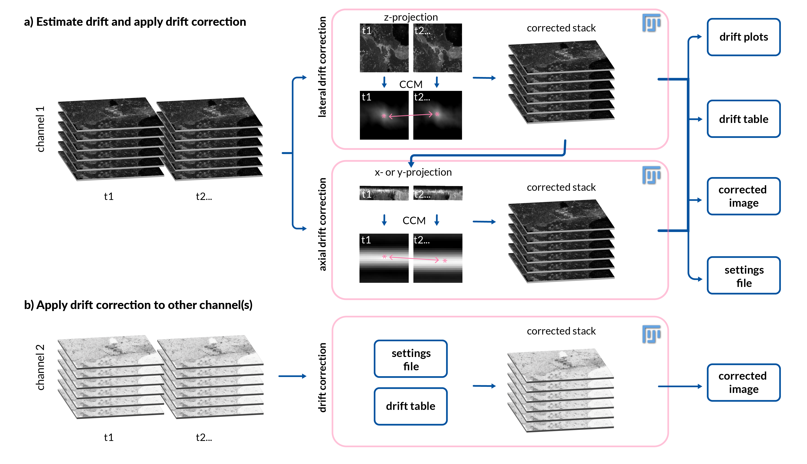

<div align="center">


# Fast4DRegPy

**Drift correction for 2D and 3D time-lapse microscopy, and channel alignment, in Python.**
*The projection-based workflow of the Fiji tool Fast4DReg, as a Python package, a desktop app and tools for napari and Fiji.*

[](LICENSE)
[](https://doi.org/10.1242/jcs.260728)
[](https://colab.research.google.com/github/CellMigrationLab/Fast4DRegPy/blob/main/notebooks/Fast4DRegApp/Fast4DRegApp.ipynb)
[](https://cellmigrationlab.github.io/LabConstrictor-Site/)

</div>

---

## What is Fast4DRegPy?

Long time-lapse acquisitions drift: the stage moves, the focus creeps, the
sample settles. Fast4DRegPy measures that drift and removes it, in X, Y and Z,
for 2D and 3D movies. It also aligns the channels of multichannel images,
which helps with microscopes whose channels are offset from each other.

It is the Python version of [Fast4DReg](https://github.com/CellMigrationLab/Fast4DReg),
the Fiji tool, and follows the same steps: it makes intensity projections,
measures the shift between them by cross-correlation (with
[NanoPyx](https://github.com/HenriquesLab/NanoPyx), in the role NanoJ has in
Fiji) and translates each frame by that shift.



*The Fast4DReg pipeline. XY drift is measured on projections over Z and
corrected first; Z drift is then measured on side projections of the
XY-corrected movie. Figure from the
[Fast4DReg repository](https://github.com/CellMigrationLab/Fast4DReg).*

**Same results as Fiji.** On the complete published Fast4DReg test movie
(25 timepoints, 69 slices, 416 × 416 pixels), the drift found by Fast4DRegPy
differs from a fresh Fiji Fast4DReg run by at most 0.005 pixels on any axis,
and the corrected movies have a correlation of 0.9999993. See
[the validation](docs/validation.md).

---

## Quickstart

Choose how you want to use it:

### 🖥️ Desktop app (no Python needed)

Download the installer for Windows, macOS or Linux from the
[latest release](https://github.com/CellMigrationLab/Fast4DRegPy/releases).
The app opens the Fast4DRegPy notebook in JupyterLab: choose a file, set the
options, press **Run registration**. How to install and open an app:
[Install an app](https://cellmigrationlab.github.io/LabConstrictor-Site/guides/install/) and
[Open and use an app](https://cellmigrationlab.github.io/LabConstrictor-Site/guides/using-apps/).

### 🔬 In napari or Fiji

The app adds two tools to napari and Fiji, **Correct drift (time-lapse)** and
**Align channels**, which work on the image you have open. Install the app,
then the LabConstrictor plugin once:
[napari](https://cellmigrationlab.github.io/LabConstrictor-Site/guides/napari/) or
[Fiji](https://cellmigrationlab.github.io/LabConstrictor-Site/guides/fiji/).
How to use them: [napari and Fiji](docs/napari_fiji.md).

### 🌐 In the browser

Run the notebook in Google Colab, nothing to install:
[Open in Colab](https://colab.research.google.com/github/CellMigrationLab/Fast4DRegPy/blob/main/notebooks/Fast4DRegApp/Fast4DRegApp.ipynb).

### 🐍 In Python

```bash
python -m pip install "fast4dregpy @ git+https://github.com/CellMigrationLab/Fast4DRegPy"
```

```python
from fast4dreg import load_tiff, register_time, save_drift_csv, save_tiff

image = load_tiff("timelapse.tif")                  # here: T, Z, Y, X
corrected, shifts = register_time(image, axes="TZYX", correct_xy=True, correct_z=True)
save_tiff("timelapse_registered.tif", corrected, axes="TZYX")
save_drift_csv("timelapse_drift.csv", shifts)        # dz, dy, dx per timepoint
```

More in [the Python guide](docs/python.md). Once a release is on PyPI,
`python -m pip install fast4dregpy` works too.

---

## Key capabilities

* **2D and 3D time-lapse drift correction**, in XY, in Z, or both.
* **Channel alignment** of 2D and 3D multichannel images.
* **The Fast4DReg settings:** projection (max or mean), reference frame (first
  or previous), time averaging, maximum expected drift, crop output, extend
  stack in Z. [How they map to the Fiji dialog](docs/fiji_compatibility.md).
* **Registration quality:** mSSIM, PSNR, Pearson correlation and NRMSE as in
  the Fast4DReg paper, temporal colour overlays and kymographs.
* **Drift tables** as CSV files, one row per timepoint or channel.
* **Fast:** on the published test movie, half the time of the Fiji macro with
  4 workers on the same computer ([timings](docs/validation.md#speed)).

---

## ⚠️ Three things to get right

1. **Say what each dimension is.** Fast4DRegPy never guesses the axes of an
   image from its shape: you give them (`TYX`, `TZYX`, `CZYX`...). A wrong
   axes string is refused with the image's shape.
2. **One timepoint for channel alignment; one channel's drift for all.**
   Channel alignment works on a single timepoint. For a multichannel
   time-lapse, the drift is measured on the reference channel and the same
   correction is applied to every channel.
3. **Z drift needs enough slices.** Z drift is measured on side projections of
   the stack. On stacks of about 10 slices or fewer it may not be found at
   all; check the `dz` column of the drift table.

More in [Troubleshooting](docs/troubleshooting.md).

---

## Documentation

**Start here**
* [Documentation index](docs/index.md)
* [Installation](docs/installation.md)
* [Step-by-step workflow and every setting](docs/workflow.md)

**Use it**
* [napari and Fiji](docs/napari_fiji.md)
* [Python guide](docs/python.md)
* [Troubleshooting and known issues](docs/troubleshooting.md)

**How it compares with Fiji**
* [Fiji compatibility](docs/fiji_compatibility.md)
* [Validation and speed](docs/validation.md)

**Develop**
* [Development and releases](docs/development.md)

---

## Citation

If you use Fast4DRegPy, please cite Fast4DReg, NanoJ and NanoPyx:

> Pylvänäinen JW, Laine RF, Saraiva BMS, Ghimire S, Follain G, Henriques R,
> Jacquemet G. **Fast4DReg – fast registration of 4D microscopy datasets.**
> *Journal of Cell Science* 136 (4), jcs260728 (2023).
> https://doi.org/10.1242/jcs.260728

> Laine RF, Tosheva KL, Gustafsson N, et al. **NanoJ: a high-performance
> open-source super-resolution microscopy toolbox.** *Journal of Physics D:
> Applied Physics* 52 (16), 163001 (2019). https://doi.org/10.1088/1361-6463/ab0261

> Saraiva BM et al. **Efficiently accelerated bioimage analysis with NanoPyx,
> a Liquid Engine-powered Python framework.** *Nature Methods* 22, 283–286
> (2025). https://doi.org/10.1038/s41592-024-02562-6

The desktop app and the napari and Fiji tools are built with
[LabConstrictor](https://cellmigrationlab.github.io/LabConstrictor-Site/).

Fast4DRegPy is released under the [MIT license](LICENSE). The Fast4DReg logo
and pipeline figure come from the
[Fast4DReg repository](https://github.com/CellMigrationLab/Fast4DReg) (MIT).
Release notes: [CHANGELOG.md](CHANGELOG.md).
