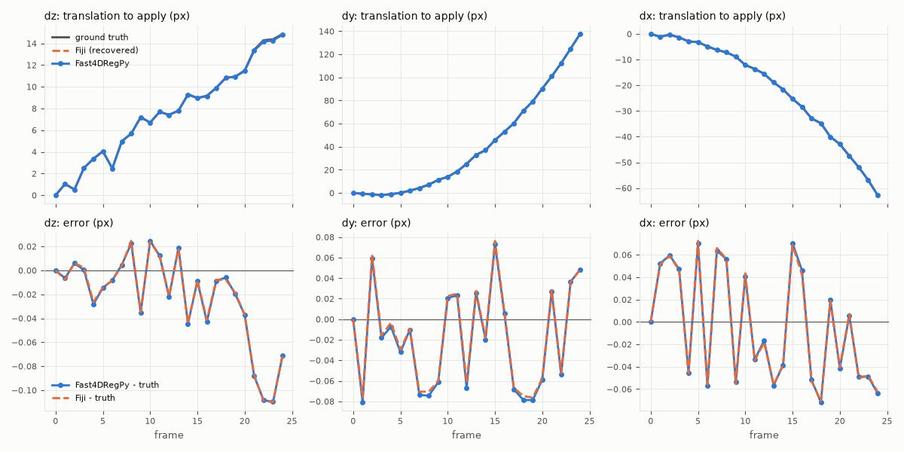
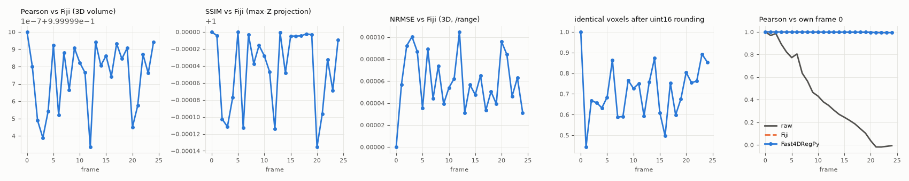
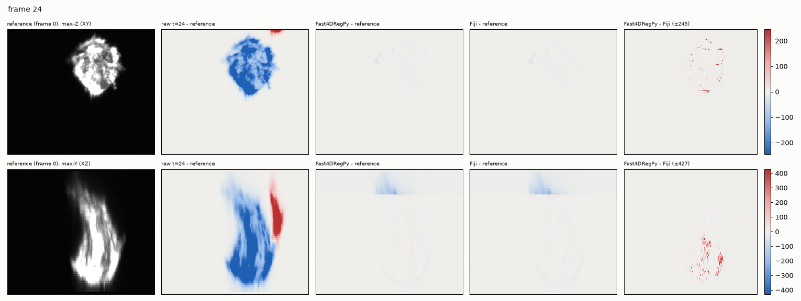

# Full-movie validation: published synthetic large-drift movie

**Result: pass.** On the complete published movie (25 timepoints x 69 Z
planes), Fast4DRegPy recovers the XYZ drift actually added to every frame
within 0.11 px. It agrees with the translations the archived Fiji Fast4DReg
run applied within 0.005 px, and its corrected volumes match the archived Fiji
volumes with Pearson ≥ 0.9999993 on every frame. The archived output crop is
2 px smaller in X and Y than the macro produces; a fresh run of the original
macro gives the same voxels in a 277 x 354 crop (see "Crop semantics").

Machine-readable results and figures are in
[`validation/results/large-drift-full-movie/`](../validation/results/large-drift-full-movie/).
Reproduce with `python validation/full_movie/validate_large_drift.py --download`
or the **full-movie validation** GitHub workflow
([`validation/README.md`](../validation/README.md)).

## Run

| Item | Value |
| --- | --- |
| Fast4DRegPy commit | `57f6766` (estimation code identical to `ee73ad4`, whose independent run gave the same numbers to 1.5e-8) |
| Environment | GitHub Actions `ubuntu-latest`, Python 3.12.14, NanoPyx 2.1.4, NumPy 2.5.3, SciPy 1.18.1, tifffile 2026.9.20, `OMP_NUM_THREADS=1` |
| Call | `estimate_time_drift(raw, axes="TZYX", projection="max", reference="first", correct_xy=True, correct_z=True, axial_projection_axis="Y", time_averaging=1, max_expected_drift=0, crop_output=False)`, then `apply_drift(raw, shifts, axes="TZYX")` (ImageJ interpolation, float32) |
| Runtime, `workers=1` | estimation 7.7 s, transform 9.7 s |
| Runtime, `workers=4` | estimation 6.7 s, transform 7.9 s |
| Peak RSS (whole validation process) | 7.0 GB |
| Serial vs parallel | shifts and corrected volumes bit-identical |

## Dataset (verified)

| | Raw | Archived Fiji result |
| --- | --- | --- |
| Zenodo record | 7514913 (v2.0 of 6534570) | same |
| Archive | `2-Synthetic-drift-dataset.zip`, MD5 `27e3623f58d23d7c50674edc9432fe1b`, 1,518,295,669 B | same |
| Member | `2.1-Synthetic-drift-files/2.1.2-LargeDrift_original.tif` | `2.2-Synthetic-drift-expected-results/2.2.1-LargeDrift_F4DReg.tif` |
| SHA-256 | `8d7f9bdd681786e975961e5c9d3e3999fcd6ffcd737d3e18268e69d209bb7c29` | `2f3e76081c5ced16a862229ee0b5042a12cf66e3e37487534229b635da22aa82` |
| Shape, axes, dtype | 25 x 69 x 416 x 416, `TZYX`, uint16 | 25 x 69 x 275 x 352, `TZYX`, uint16 |
| Calibration | 6.311692 px/µm (0.158 µm) in XY; Z spacing 0.5 µm | same |
| Written by | ImageJ 1.53f | ImageJ 1.53f |

The archive contains no settings file or drift table for this result. Its
other expected results are the Fijiyama and Correct3DD outputs.

## Fiji settings

**Established from the data**

- 32-bit processing ("Save RAM" off), then one conversion to uint16: applying
  ImageJ's two-pass bicubic translation in float to frame 6 reproduces 99.99%
  of archived voxels exactly (max difference 1); the 16-bit per-pass model does
  not (max difference 282).
- Bicubic translation with zero fill; XY pass then Z pass.
- Output cropped in XY, origin (y, x) = (138, 0); Z not extended (69 slices).
- Fiji's applied translation for every frame (recovered below; fit residual
  RMSE ≤ 0.019 grey levels, ≥ 99.97% identical voxels on the fit blocks).

**Inferred by elimination.** Each variant was estimated from the raw movie
and compared with Fiji's recovered translations:

| Variant | max \|Δ\| vs Fiji (dz, dy, dx) px |
| --- | --- |
| max projection, first frame, Top reslice, no averaging, automatic search | **0.0021, 0.0047, 0.0039** |
| average projection | 0.033, 0.076, 0.142 |
| previous-frame reference | 0.347, 0.170, 0.145 |
| Left reslice | 0.022, 0.0047, 0.0039 |
| crop before Z estimation | 0.0022, 0.0047, 0.0039 |
| time averaging 2 | 0.880, 6.241, 2.038 |

So XY and Z used **maximum projection, first-frame reference and no time
averaging**, and Z used the **Top** reslice. The maximum expected drift was
0 (automatic) or large enough to contain the 138 px Y drift; the Java dialog
default of 10 cannot have been used. Whether Fiji estimated Z from the cropped
stack (v1 behaviour; axial stretch 5 instead of 6) **cannot be determined**:
both give the same Z within 0.002 px.

**Confirmed by re-running Fiji:** the v2.1 macro with these settings and
"Crop output" on reproduces every archived voxel (100% identical in the common
region), so they are the settings of the archived result. Fast4DRegPy
differs from the fresh Fiji drift table by at most 0.0022 / 0.0047 / 0.0039 px
(Z / Y / X), the same as from the recovered translations. The original macro
version (v1 or v2.x) remains unknown; v1 and v2.1 with crop on give the same
result.

**Speed on the same runner:** Fiji 41 s, Fast4DRegPy 19.5 s (`workers=1`) and
14.9 s (`workers=4`); see `performance.md`.

## 1. Drift trajectory vs ground truth

Ground truth is the displacement the generator actually added. It was
recovered for every frame by fitting ImageJ's translation of raw frame 0 to
raw frame t. The recovered values match the five published Fig. S1A values
available in the repository within 0.001 px (frames 6, 12, 18, 24; frame 0 is
not drifted). Expected translation = −(added displacement); order `(dz, dy, dx)`.

| Axis | mean \|err\| | median \|err\| | RMSE | max \|err\| (frame) | bias |
| --- | ---: | ---: | ---: | ---: | ---: |
| Z | 0.030 | 0.020 | 0.043 | 0.110 (23) | −0.023 |
| Y | 0.044 | 0.048 | 0.051 | 0.081 (1) | −0.019 |
| X | 0.046 | 0.049 | 0.050 | 0.072 (18) | −0.004 |

Fiji's own errors against the same ground truth are statistically identical
(max 0.110 / 0.076 / 0.072 px; bias −0.023 / −0.016 / −0.004). The residual
error is therefore a property of the Fast4DReg algorithm (projection-based
estimation), not of this implementation. All values are far inside the
0.75 px threshold used previously.

### Per-frame table (px)

"Fiji − ours" is the difference from Fiji's recovered applied translation.

| frame | expected_dz | estimated_dz | error_dz | expected_dy | estimated_dy | error_dy | expected_dx | estimated_dx | error_dx | Fiji − ours dz | Fiji − ours dy | Fiji − ours dx |
|---:|---:|---:|---:|---:|---:|---:|---:|---:|---:|---:|---:|---:|
| 0 | 0.000 | 0.000 | 0.000 | 0.000 | 0.000 | 0.000 | 0.000 | 0.000 | 0.000 | 0.0000 | 0.0000 | 0.0000 |
| 1 | 1.042 | 1.035 | -0.006 | -0.689 | -0.770 | -0.081 | -1.154 | -1.102 | 0.052 | -0.0013 | 0.0047 | -0.0009 |
| 2 | 0.526 | 0.532 | 0.006 | -1.261 | -1.202 | 0.059 | -0.310 | -0.251 | 0.059 | 0.0002 | 0.0033 | -0.0004 |
| 3 | 2.517 | 2.517 | 0.000 | -1.961 | -1.979 | -0.018 | -1.384 | -1.337 | 0.047 | 0.0019 | 0.0022 | -0.0010 |
| 4 | 3.376 | 3.347 | -0.028 | -1.000 | -1.007 | -0.007 | -2.878 | -2.923 | -0.045 | 0.0018 | 0.0039 | -0.0004 |
| 5 | 4.064 | 4.050 | -0.015 | 0.073 | 0.041 | -0.032 | -3.222 | -3.152 | 0.070 | 0.0002 | 0.0024 | 0.0024 |
| 6 | 2.479 | 2.471 | -0.008 | 2.012 | 2.002 | -0.010 | -4.829 | -4.886 | -0.057 | -0.0001 | 0.0007 | 0.0010 |
| 7 | 4.968 | 4.973 | 0.005 | 4.294 | 4.220 | -0.074 | -6.270 | -6.206 | 0.064 | -0.0006 | 0.0031 | 0.0022 |
| 8 | 5.673 | 5.695 | 0.023 | 7.210 | 7.136 | -0.074 | -7.185 | -7.129 | 0.056 | 0.0021 | 0.0040 | 0.0001 |
| 9 | 7.213 | 7.178 | -0.035 | 11.375 | 11.314 | -0.061 | -8.818 | -8.872 | -0.054 | 0.0005 | 0.0011 | -0.0018 |
| 10 | 6.684 | 6.708 | 0.025 | 13.946 | 13.967 | 0.021 | -12.111 | -12.070 | 0.041 | -0.0007 | 0.0019 | 0.0029 |
| 11 | 7.679 | 7.691 | 0.012 | 18.579 | 18.602 | 0.023 | -13.614 | -13.647 | -0.033 | -0.0003 | 0.0018 | -0.0008 |
| 12 | 7.424 | 7.402 | -0.022 | 25.245 | 25.178 | -0.067 | -15.533 | -15.550 | -0.017 | 0.0010 | 0.0047 | -0.0017 |
| 13 | 7.789 | 7.808 | 0.019 | 32.932 | 32.958 | 0.026 | -18.849 | -18.906 | -0.057 | -0.0015 | 0.0018 | 0.0006 |
| 14 | 9.315 | 9.270 | -0.044 | 37.043 | 37.023 | -0.020 | -21.571 | -21.610 | -0.039 | 0.0001 | 0.0015 | 0.0003 |
| 15 | 8.970 | 8.961 | -0.009 | 45.680 | 45.753 | 0.073 | -25.307 | -25.237 | 0.070 | 0.0007 | 0.0033 | -0.0017 |
| 16 | 9.177 | 9.134 | -0.043 | 52.989 | 52.994 | 0.005 | -28.408 | -28.362 | 0.046 | 0.0017 | 0.0019 | -0.0039 |
| 17 | 9.910 | 9.901 | -0.009 | 60.376 | 60.308 | -0.068 | -32.839 | -32.891 | -0.052 | 0.0009 | 0.0016 | -0.0008 |
| 18 | 10.828 | 10.822 | -0.006 | 71.217 | 71.138 | -0.079 | -34.758 | -34.830 | -0.072 | -0.0018 | 0.0038 | 0.0009 |
| 19 | 10.941 | 10.921 | -0.020 | 79.338 | 79.259 | -0.079 | -40.054 | -40.034 | 0.020 | 0.0011 | 0.0024 | -0.0007 |
| 20 | 11.504 | 11.467 | -0.037 | 90.376 | 90.317 | -0.059 | -42.871 | -42.912 | -0.041 | -0.0001 | 0.0014 | 0.0008 |
| 21 | 13.412 | 13.324 | -0.088 | 100.918 | 100.945 | 0.027 | -47.476 | -47.470 | 0.006 | 0.0008 | 0.0015 | 0.0015 |
| 22 | 14.292 | 14.184 | -0.108 | 112.391 | 112.337 | -0.054 | -51.852 | -51.901 | -0.049 | -0.0005 | 0.0017 | -0.0012 |
| 23 | 14.383 | 14.273 | -0.110 | 124.902 | 124.939 | 0.037 | -56.875 | -56.924 | -0.049 | -0.0003 | -0.0004 | 0.0008 |
| 24 | 14.871 | 14.800 | -0.071 | 137.609 | 137.657 | 0.048 | -62.743 | -62.807 | -0.064 | 0.0004 | 0.0002 | 0.0013 |



### Z stress test

The Z error grows with the Z shift and time: Spearman ρ of |Z error| with
|dz| = 0.65, frame = 0.64, |dy| = 0.60, |dx| = 0.64, overlap fraction = −0.65.
These correlates are themselves collinear because drift increases with time.
The largest Z errors (−0.09 to −0.11 px, frames 21–23) occur where Z drift
exceeds 13 slices (19% of the stack) and XY drift exceeds 100 px, so the
projections share the least content. Fiji shows the same errors to within
0.002 px, so no Z-specific implementation bias remains.

## 2. Comparison with the archived Fiji output

The Fast4DRegPy output (full field, float32) was cropped at Fiji's origin
(138, 0) to 275 x 352. Frame 0 validates the mapping: it is bit-identical to
the archive.

| Metric (frames 1–24) | min | median | worst frame |
| --- | ---: | ---: | ---: |
| Pearson, 3D volume | 0.9999993 | 0.9999998 | 12 |
| SSIM, 3D volume | 0.9999997 | 0.9999999 | 1 |
| NRMSE (RMSE / range), 3D | max 1.0e-4 | 5.7e-5 | 12 |
| MAE, 3D (grey levels, range 65,280) | max 1.25 | 0.73 | 16 |
| Pearson, max-Z projection | 0.9999954 | 0.9999991 | 20 |
| SSIM, max-Z projection | 0.99986 | 0.99997 | 20 |
| Pearson, max-Y (XZ) projection | 0.9999927 | 0.9999984 | 20 |
| Pearson, slices z = 17 / 34 / 51 | ≥ 0.9999994 | 0.9999999 | 16 / 16 / 12 |
| identical voxels after uint16 rounding | 0.443 | 0.726 | 1 |

The identical-voxel fraction is below 1 because Fast4DRegPy's translations
differ from Fiji's by up to 0.005 px, which flips uint16 rounding and can move
a voxel across ImageJ's zero-fill boundary. The maximum absolute difference is
therefore up to 1,857 grey levels at a few voxels on that boundary. Applying
Fiji's *own* translation reproduces the archive exactly
(`tests/test_zenodo_xyzt.py`).

### Per-frame metrics

| frame | Pearson 3D | SSIM 3D | NRMSE 3D | MAE 3D | Pearson max-Z | SSIM max-Z | Pearson max-Y (XZ) | identical uint16 voxels | raw vs frame 0 | Fast4DRegPy vs frame 0 | Fiji vs frame 0 |
|---:|---:|---:|---:|---:|---:|---:|---:|---:|---:|---:|---:|
| 0 | 1.0000000 | 1.0000000 | 0.0e+00 | 0.00 | 1.0000000 | 1.00000 | 1.0000000 | 1.000 | 1.000 | 1.0000 | 1.0000 |
| 1 | 0.9999998 | 0.9999997 | 5.7e-05 | 1.24 | 0.9999998 | 1.00000 | 0.9999997 | 0.443 | 0.968 | 0.9993 | 0.9994 |
| 2 | 0.9999995 | 0.9999998 | 9.2e-05 | 0.80 | 0.9999962 | 0.99990 | 0.9999942 | 0.666 | 0.985 | 0.9990 | 0.9990 |
| 3 | 0.9999994 | 0.9999998 | 1.0e-04 | 0.93 | 0.9999958 | 0.99989 | 0.9999935 | 0.658 | 0.893 | 0.9987 | 0.9987 |
| 4 | 0.9999995 | 0.9999998 | 8.7e-05 | 1.02 | 0.9999974 | 0.99992 | 0.9999961 | 0.632 | 0.823 | 0.9989 | 0.9989 |
| 5 | 0.9999999 | 0.9999999 | 3.5e-05 | 0.73 | 0.9999999 | 1.00000 | 1.0000000 | 0.684 | 0.772 | 0.9990 | 0.9990 |
| 6 | 0.9999995 | 0.9999999 | 8.9e-05 | 0.45 | 0.9999959 | 0.99989 | 0.9999936 | 0.864 | 0.804 | 0.9989 | 0.9989 |
| 7 | 0.9999999 | 0.9999998 | 4.4e-05 | 0.90 | 0.9999998 | 1.00000 | 0.9999997 | 0.588 | 0.634 | 0.9988 | 0.9988 |
| 8 | 0.9999997 | 0.9999997 | 7.4e-05 | 1.09 | 0.9999987 | 0.99996 | 0.9999980 | 0.591 | 0.564 | 0.9985 | 0.9985 |
| 9 | 0.9999999 | 0.9999999 | 3.9e-05 | 0.57 | 0.9999995 | 0.99998 | 0.9999987 | 0.765 | 0.464 | 0.9981 | 0.9981 |
| 10 | 0.9999998 | 0.9999999 | 5.4e-05 | 0.74 | 0.9999990 | 0.99997 | 0.9999984 | 0.726 | 0.431 | 0.9985 | 0.9985 |
| 11 | 0.9999998 | 0.9999999 | 6.2e-05 | 0.54 | 0.9999982 | 0.99995 | 0.9999966 | 0.750 | 0.381 | 0.9977 | 0.9977 |
| 12 | 0.9999993 | 0.9999997 | 1.0e-04 | 1.10 | 0.9999958 | 0.99989 | 0.9999935 | 0.593 | 0.349 | 0.9977 | 0.9977 |
| 13 | 0.9999999 | 0.9999999 | 3.1e-05 | 0.62 | 1.0000000 | 1.00000 | 0.9999999 | 0.758 | 0.307 | 0.9984 | 0.9984 |
| 14 | 0.9999998 | 0.9999999 | 5.7e-05 | 0.40 | 0.9999983 | 0.99995 | 0.9999972 | 0.872 | 0.270 | 0.9974 | 0.9974 |
| 15 | 0.9999999 | 0.9999998 | 4.8e-05 | 0.89 | 0.9999998 | 1.00000 | 0.9999995 | 0.609 | 0.244 | 0.9979 | 0.9979 |
| 16 | 0.9999997 | 0.9999997 | 6.5e-05 | 1.25 | 0.9999997 | 1.00000 | 0.9999994 | 0.496 | 0.216 | 0.9976 | 0.9976 |
| 17 | 0.9999999 | 0.9999999 | 3.3e-05 | 0.57 | 0.9999998 | 1.00000 | 0.9999994 | 0.753 | 0.186 | 0.9976 | 0.9976 |
| 18 | 0.9999998 | 0.9999998 | 5.0e-05 | 0.97 | 0.9999999 | 1.00000 | 0.9999998 | 0.598 | 0.144 | 0.9973 | 0.9973 |
| 19 | 0.9999999 | 0.9999999 | 3.9e-05 | 0.74 | 0.9999999 | 1.00000 | 0.9999997 | 0.676 | 0.103 | 0.9973 | 0.9973 |
| 20 | 0.9999995 | 0.9999998 | 9.6e-05 | 0.49 | 0.9999954 | 0.99986 | 0.9999927 | 0.804 | 0.036 | 0.9962 | 0.9962 |
| 21 | 0.9999996 | 0.9999999 | 8.4e-05 | 0.60 | 0.9999966 | 0.99990 | 0.9999949 | 0.755 | -0.019 | 0.9946 | 0.9946 |
| 22 | 0.9999999 | 0.9999999 | 4.6e-05 | 0.52 | 0.9999991 | 0.99997 | 0.9999980 | 0.762 | -0.019 | 0.9936 | 0.9936 |
| 23 | 0.9999998 | 0.9999999 | 6.3e-05 | 0.36 | 0.9999979 | 0.99993 | 0.9999971 | 0.892 | -0.013 | 0.9937 | 0.9937 |
| 24 | 0.9999999 | 1.0000000 | 3.1e-05 | 0.38 | 0.9999996 | 0.99999 | 0.9999989 | 0.854 | -0.007 | 0.9937 | 0.9937 |



## 3. Improvement over the unregistered movie

Independent of Fiji, each frame's Pearson correlation with frame 0 in the
common region rises from 0.968 (frame 1) … −0.019 (frame 22) for the raw movie to
0.9993 (frame 1) … 0.9936 (frame 22) after Fast4DRegPy registration.
**No frame gets worse.** Fiji's values match Fast4DRegPy's to four decimals.

## 4. Difference images

Rows: max-Z (XY) and max-Y (XZ) projections. Columns: reference (frame 0),
raw − reference, Fast4DRegPy − reference, Fiji − reference, and
Fast4DRegPy − Fiji on its own scale.

- [frame 0](../validation/results/large-drift-full-movie/difference_frame00.png)
  (mapping check: all differences zero)
- [frame 1](../validation/results/large-drift-full-movie/difference_frame01.png)
  (early moving frame; worst SSIM and identical-voxel fraction)
- [frame 12](../validation/results/large-drift-full-movie/difference_frame12.png)
  (middle; worst 3D Pearson)
- [frame 24](../validation/results/large-drift-full-movie/difference_frame24.png)
  (final)



## Crop semantics

The macro crops the XY-corrected stack to

```
x0 = ceil(max dx), y0 = ceil(max dy)
width  = W - ceil(max dx) + ceil(min dx)
height = H - ceil(max dy) + ceil(min dy)      (extrema include 0)
```

(`getMinMaxXYFromDriftTable_xy` + `makeRectangle`; identical in the v1 macro
and in the June 2022 prototypes). With Fiji's translations (max dy = 137.657,
min dy = −1.977 at frame 3, max dx = 0, min dx = −62.806) this gives
**277 x 354 at (138, 0)**. The archive is **275 x 352 at (138, 0)**.

A fresh run of the original macro on the same raw file, with the inferred
settings and "Crop output" on (`.github/workflows/fiji-full-movie-timing.yml`),
resolves this. It produces a **277 x 354** stack, and over the common
275 x 352 region its voxels are **100% identical** to the archive after uint16
conversion. The archived file is therefore this computation with 2 further
pixels removed from the right and bottom edges, probably trimmed by hand.
`fiji_crop_bounds()` implements the macro's formula and gives the same
277 x 354 as the fresh Fiji run; Fast4DRegPy with `crop_output=True` produces
the same geometry (Pearson ≥ 0.9999998 against the fresh Fiji output).

Registration parity and output-cropping parity therefore both hold against the
Fiji macro. Only the archived file's extra 2 px trim is not reproduced.

## Thresholds

The previous thresholds (0.75 px; Pearson > 0.98) hold on every frame with
large margins. Measured worst cases are 0.110 px vs truth, 0.0047 px vs Fiji
and Pearson 0.9999993.

From these measurements the `strict` preset, now the default of the script
and workflow, is set to:

| Gate | Threshold | Measured worst | Rationale |
| --- | ---: | ---: | --- |
| shift vs Fiji | 0.01 px | 0.0047 px | implementation parity; ~2x the NanoPyx/NanoJ optimiser difference |
| 3D Pearson vs Fiji | > 0.99999 | 0.9999993 | 14x the measured shortfall from 1 |
| shift vs ground truth | 0.15 px | 0.110 px | algorithm-level sanity bound; Fiji itself reaches 0.110 px (Z, frames 22–23) |

A tighter truth gate would test the Fast4DReg algorithm rather than this
implementation; the Fiji gate is the sensitive regression check. The
`baseline` preset (0.75 px, Pearson > 0.98) remains available.
