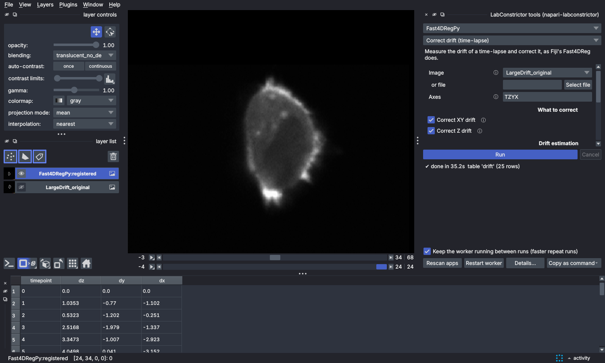
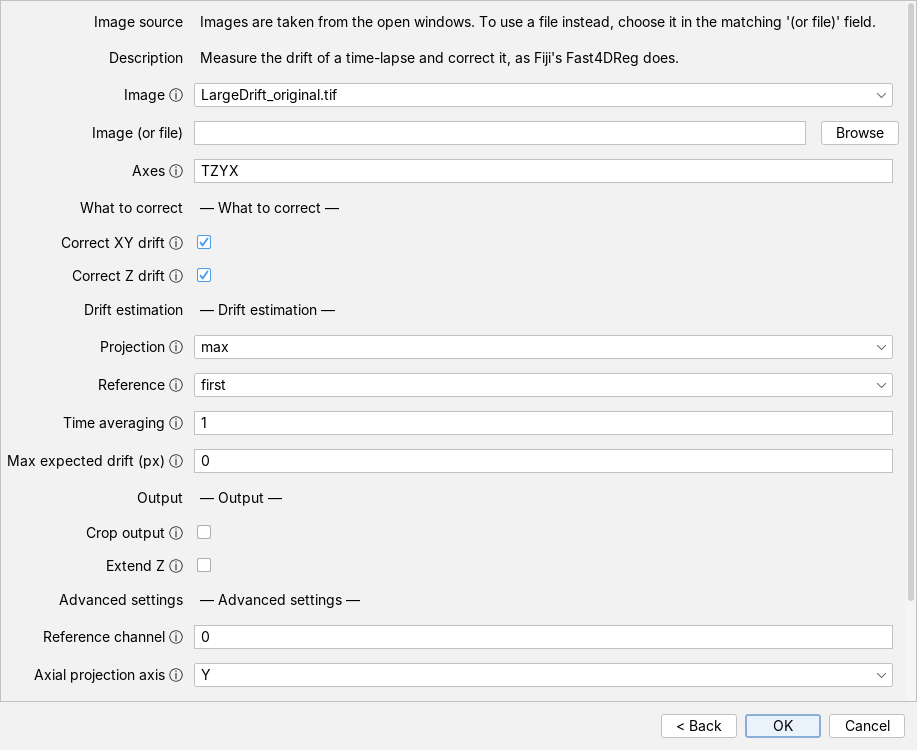
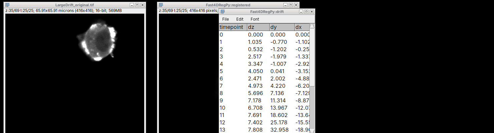
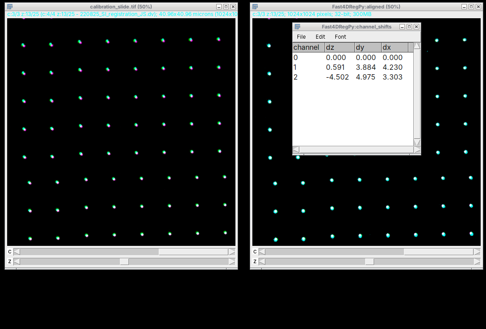

# Fast4DRegPy in napari and Fiji

[⬅️ Documentation index](index.md)

The Fast4DRegPy app adds two tools to napari and Fiji:

- **Correct drift (time-lapse)**: corrects the drift of the open time-lapse
  and gives the corrected movie and the drift table.
- **Align channels**: aligns the channels of the open image on a reference
  channel and gives the aligned image and the shift of each channel.

They run Fast4DRegPy in the app's own Python, through
[LabConstrictor](https://cellmigrationlab.github.io/LabConstrictor-Site/guides/image-software/):
napari and Fiji do not need Fast4DRegPy, NanoPyx or anything else. They give
the same results as the notebook and the Python package (checked on the
published Fast4DReg movie: identical corrected voxels).

## Install (once)

1. Install the [Fast4DRegPy app](installation.md#desktop-app).
2. Install the LabConstrictor plugin of the program you use:
   [napari plugin](https://cellmigrationlab.github.io/LabConstrictor-Site/guides/napari/) or
   [Fiji plugin](https://cellmigrationlab.github.io/LabConstrictor-Site/guides/fiji/).

The plugin finds every LabConstrictor app installed on the computer. What
each program can do with the tools of an app:
[What works where](https://cellmigrationlab.github.io/LabConstrictor-Site/guides/capabilities/).

## In napari

1. Open your movie (*File > Open*), or choose a file in the form.
2. Open *Plugins > LabConstrictor tools*, choose **Fast4DRegPy**, then the tool.
3. Choose the image layer and type its **Axes**. A napari layer is usually
   `TYX` (2D time-lapse) or `TZYX` (3D); napari shows multichannel images as
   one layer per channel, so for **Align channels** give a file with a C axis.
4. Click **Run**. The corrected movie appears as a new layer
   (`Fast4DRegPy:registered`) with the same sliders, and the drift table opens
   below the viewer.

*Correct drift (time-lapse) in napari on the published Fast4DReg large-drift
movie (25 timepoints × 69 slices, XY and Z correction): the form on the right,
the corrected movie, and the drift table with one row per timepoint
(translation applied, in pixels).*

## In Fiji

1. Open your movie.
2. Run *Plugins > LabConstrictor > LabConstrictor Tools...*, choose
   **Fast4DRegPy**, then the tool.
3. Choose the image and type its **Axes**. Fiji sends a hyperstack in the
   order T, Z, C, Y, X and leaves out the dimensions of size 1: a 3D
   time-lapse is `TZYX`, a 2D one `TYX`, a 3D composite image `ZCYX`.
4. Click **OK**. Progress is shown in the status bar and the Log window. The
   corrected image opens in a new window and the drift table in a Results
   window.

*The form of Correct drift (time-lapse) in Fiji, on the published large-drift
movie. Advanced settings are at the bottom.*

*The raw movie (left) and the corrected one (`Fast4DRegPy:registered`), both at
the last timepoint, and the drift table. The result is a hyperstack with its Z
and T sliders.*

*Align channels in Fiji on the published calibration slide (3 channels × 25
slices, XY and Z): the raw image (left), the aligned one and the shift of each
channel. Both are shown as composites (Image > Color > Make Composite) so the
colour fringes of the raw beads are visible.*

## The settings

The forms have the settings of the [notebook](workflow.md#the-settings), with
the same names, plus **Axes**. The **Reference channel** is counted from 0
(Fiji counts channels from 1: Fiji's channel 1 is 0 here).

## Good to know

- **Results keep their dimensions.** In Fiji the corrected movie opens as a
  hyperstack with its time points, slices and channels (with LabConstrictor
  tools 0.3.0a4 or later; older ones give one long stack, fixed with *Image >
  Hyperstacks > Stack to Hyperstack*). napari keeps the dimensions.
- **Corrected images are 32-bit** (`float32`) unless you choose the output type
  `input` (advanced settings).
- **The result is a copy.** Your image is not changed. The result files
  (TIFF and CSV) are kept in `~/.labconstrictor/results/`, one folder per run;
  `labconstrictor-tools prune` removes old runs and keeps the newest 20.
- **Large movies:** napari and Fiji send the whole image to the app. A movie
  of several GB needs that much free memory twice (the image and its
  corrected copy).
- **Image with exactly 3 or 4 planes in Fiji** (for example 3 channels): the
  result needs a version of the LabConstrictor tools that includes
  [LabConstrictor-Tools#163](https://github.com/CellMigrationLab/LabConstrictor-Tools/pull/163);
  with an older one, Fiji cannot open it (napari can).
- **QuPath** is not offered for Fast4DRegPy.

## Without napari or Fiji

The same tools run from a terminal, with the app's Python
(`labconstrictor-tools run Fast4DRegPy correct_drift image=movie.tif axes=TZYX
correct_z=true`), and the napari panel's *Copy as command* gives that line for
your last run. See the
[LabConstrictor tools documentation](https://cellmigrationlab.github.io/LabConstrictor-Tools/).

For developers: the tools are declared in `src/fast4dreg_lc_tools/` and tested
in `lc_tests/` (see [Development](development.md)).
