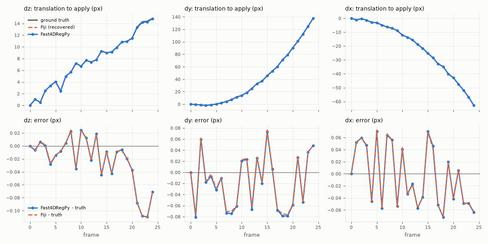

# Validation

[⬅️ Documentation index](index.md)

Fast4DRegPy is tested at three levels: small synthetic unit tests, fixtures
generated by the real Fiji/ImageJ code, and the complete published Fast4DReg
large-drift movie.

The full-movie comparison is the most informative check because it runs all
25 timepoints and all 69 Z planes and compares both the estimated drift and the
corrected voxels.

## Published large-drift movie

The dataset is from
[Zenodo record 7514913](https://zenodo.org/records/7514913),
`2-Synthetic-drift-dataset.zip`.

The raw movie has shape 25 × 69 × 416 × 416 (`TZYX`, uint16). The archive
also contains `2.2.1-LargeDrift_F4DReg.tif`, produced by Fiji Fast4DReg.

The comparison used maximum projection, first-frame reference, no time
averaging, automatic search and Top reslice. `OMP_NUM_THREADS=1` was used to
remove small OpenMP reduction-order differences from NanoPyx.

### Drift estimates

Across all 25 frames:

| Error in pixels | Z | Y | X |
| --- | ---: | ---: | ---: |
| Fast4DRegPy vs synthetic drift, mean absolute | 0.030 | 0.044 | 0.046 |
| Fast4DRegPy vs synthetic drift, maximum absolute | 0.110 | 0.081 | 0.072 |
| Fresh Fiji vs synthetic drift, mean absolute | 0.030 | 0.043 | 0.046 |
| Fresh Fiji vs synthetic drift, maximum absolute | 0.110 | 0.076 | 0.072 |
| Fast4DRegPy vs fresh Fiji, maximum absolute | 0.0021 | 0.0047 | 0.0039 |

The largest differences from the synthetic ground truth occur late in the
movie, when the imposed drift is large and overlap with frame 0 is reduced.



### Corrected volumes

The Fast4DRegPy output was mapped to the region retained by Fiji and compared
frame by frame.

| Worst value over the movie | Result |
| --- | ---: |
| Whole-volume Pearson correlation | 0.9999993 |
| Whole-volume SSIM | 0.9999997 |
| Whole-volume mean absolute difference | 1.25 grey levels |
| Max-Z Pearson correlation | 0.9999954 |

Every frame became more correlated with frame 0 after registration. The
minimum post-registration correlation with frame 0 was 0.9936; the raw movie
fell as low as −0.0189.

The complete per-frame tables, machine-readable summaries and difference
images are in
[`validation/results/large-drift-full-movie/`](../validation/results/large-drift-full-movie/).

### Fresh Fiji run

The original Fiji macro was also rerun from source on the same GitHub Actions
runner used to time Fast4DRegPy.

| Program | Recorded time |
| --- | ---: |
| Fiji Fast4DReg macro | 41.0 s |
| Fast4DRegPy, 1 transform worker | 19.5 s |
| Fast4DRegPy, 4 transform workers | 14.9 s |

The runner had 2 CPUs. These figures are useful for reproducing that run, not
as a general benchmark across machines.

The fresh Fiji output had shape 25 × 69 × 277 × 354. The archived Fiji file is
two pixels smaller in Y and X; its common region is identical to the fresh Fiji
output after uint16 conversion. Fast4DRegPy with `crop_output=True` produces
the fresh Fiji dimensions.

## Speed

The same movie, the same settings as the Fiji run (maximum projection, first
frame, no averaging, automatic search, Top reslice, XY and Z correction, crop
output) and `OMP_NUM_THREADS=1`, timed on one computer: 4 CPUs, 15 GB of
memory, Linux. Fiji is the original `time_estimate+apply.ijm` macro run
headless in ImageJ 1.53t with the Fast4DReg plugin built from source
(`validation/fiji/compare_with_fiji.py`). "Through napari or Fiji" is the
**Correct drift (time-lapse)** tool run by the LabConstrictor worker of the
installed app (`labconstrictor-tools run`), which is what napari and Fiji
call: it includes reading the TIFF and writing the 32-bit result.

| How | 1 worker | 4 workers |
| --- | ---: | ---: |
| Fiji Fast4DReg macro (time it reports; 34 s with Java start-up) | 32 s | — |
| Fast4DRegPy, Python | 40.4 s | 16.0 s |
| Fast4DRegPy through napari or Fiji (the tool) | 41.8 s | 18.3 s |

With 4 workers Fast4DRegPy took half the time of the Fiji macro; with 1 worker
it was slower than Fiji on this computer. On the 2-CPU GitHub runner above,
the order was different (Fiji 41 s, Fast4DRegPy 19.5 s with 1 worker): timings
depend on the machine, so measure on yours. `workers` never changes the
result. Fiji's peak memory was 4.2 GB; Fast4DRegPy's 5.5 GB, because the
corrected movie is kept as 32-bit.

Going through napari or Fiji adds 1.5–2.5 s here, and changes nothing in the
result: the tool's drift table is identical to the Python one and differs
from the fresh Fiji run by at most 0.0047 pixels; without cropping, its
corrected movie is voxel-for-voxel identical to Python's, and the drift passes the strict gate
(0.0047 pixels from Fiji, 0.11 pixels from the known drift).

## Small Fiji-generated fixtures

The automated test suite includes outputs made by the real Fiji macro and
ImageJ interpolation code. These cover default registration, average
projection, previous-frame reference, Left reslice, time averaging, cropping,
Z extension and bounded search behavior.

The tests also include:

- five max-Z frames from the published movie with published drift values;
- a 3D extract of frames 0 and 6 with the archived Fiji result;
- ImageJ interpolation and scaling fixtures.

The large 3D fixture remains in the repository for CI but is excluded from the
source distribution.

## What has not been validated

The current reference set does not establish Fiji parity for channel
registration, Save RAM mode, or a second 3D geometry with a substantially
different lateral-size/Z-slice ratio. Those remain useful independent tests.

## Re-running the full comparison

Install the validation dependencies and run:

```bash
python -m pip install -e ".[validation]"
python validation/full_movie/validate_large_drift.py --download
```

The script downloads the pinned 1.5 GB archive only when requested, verifies
its checksum, records software versions and commit identity, and writes CSV,
JSON and PNG results. It exits non-zero when a validation gate fails.

The default strict gate requires:

- no axis to differ from fresh Fiji by more than 0.01 pixels;
- no axis to differ from the recovered synthetic drift by more than 0.15 pixels;
- whole-volume Pearson correlation with Fiji above 0.99999;
- registration to improve every frame;
- serial and parallel results to be identical.

The repository also has manual **full-movie validation** and
**fiji comparison** Actions workflows. Details for reproducing the Fiji
run locally are in [validation/README.md](../validation/README.md).

## Data licence

The Fast4DReg dataset is CC BY 4.0. Test-data directories derived from it carry
their own attribution files.
