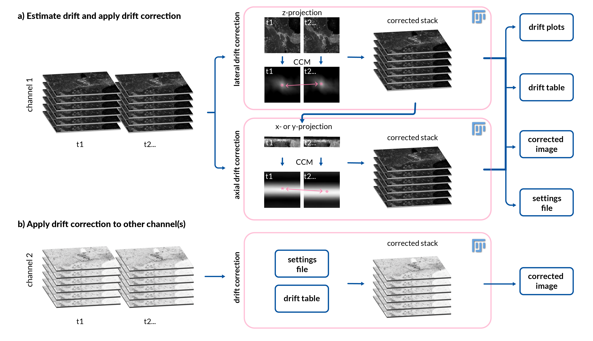

# Step-by-step workflow

[⬅️ Documentation index](index.md)

This page follows a movie from the file to the corrected result, in the
notebook of the [desktop app or Colab](installation.md). The napari and Fiji
tools have the same settings: see [napari and Fiji](napari_fiji.md).

## How the correction works

Fast4DRegPy follows the steps of the Fiji tool
[Fast4DReg](https://github.com/CellMigrationLab/Fast4DReg):

**XY correction (2D and 3D)**

1. For each timepoint, the volume is projected over Z (maximum or average
   intensity), which gives a 2D movie. A 2D movie is used as it is.
2. The shift between each frame and the reference frame is measured by
   cross-correlation: the position of the peak of the cross-correlation map is
   the shift. The reference is either the first frame or the previous one.
3. Each frame is translated by its shift.

**Z correction (3D only)**

4. The XY-corrected movie is projected from the side (along Y, Fiji's *Top*,
   or along X, *Left*), which gives a 2D movie of Z against X (or Y).
5. The Z shift is measured on that movie in the same way.
6. Each volume is translated in Z.

*Figure from the [Fast4DReg repository](https://github.com/CellMigrationLab/Fast4DReg).*

Channel alignment measures the shift of each channel against a reference
channel in the same way, for one timepoint.

## Before you start

**Time-lapse drift correction** needs one movie: a 2D (T, Y, X) or 3D
(T, Z, Y, X) time-lapse, optionally with channels. The drift is measured on one
channel (the *reference channel*) and the same correction is applied to all
channels. Choose the channel with the most stable structures, for example the
endothelium rather than the migrating cancer cells.

Unlike the Fiji macro, you do not need to split the channels: give the
multichannel movie and its axes (for example `TCZYX`). To measure the drift on
one file and apply it to another, use Python (`estimate_time_drift` then
`apply_drift`, see the [Python guide](python.md#measure-and-apply-separately)).

**Channel alignment** needs one timepoint with all channels in one file: a 2D
(C, Y, X) or 3D (C, Z, Y, X) image. Combine separate channel files first.

**The file** is a TIFF. In Fiji, *File > Save As > Tiff...* keeps the
dimensions of a hyperstack.

**The axes.** Fast4DRegPy never guesses what the dimensions of your image
are: you give one letter per dimension, in the order of the file.

| Your image | Axes |
|---|---|
| 2D time-lapse | `TYX` |
| 3D time-lapse | `TZYX` |
| 3D time-lapse with channels, saved by Fiji | `TZCYX` |
| 2D image with channels | `CYX` |
| 3D image with channels, saved by Fiji | `ZCYX` |

Fiji saves hyperstacks in the order T, Z, C, Y, X and leaves out the
dimensions of size 1. If the axes do not match the image, Fast4DRegPy stops
and tells you the image's shape.

**Z drift needs enough slices.** Z drift is measured on a side view of the
stack (Z against X), stretched to a square and cross-correlated. On a thin
stack that view is only a few rows tall: its top and bottom edges and its
brightness profile along Z do not move with the drift, and a drift of one or
two slices replaces a large part of it. The estimate is then pulled towards
zero. On stacks of about 10 slices or fewer, Z drift is underestimated: by a
quarter to a half for sharp, scattered structures, down to almost zero for
smooth texture. With about 20 slices it is measured correctly. The original
Fiji Fast4DReg gives exactly the same numbers on such stacks; this is a
property of the method, not of the Python version. If you need Z correction,
acquire more slices, and check the `dz` column of the drift table.

| Test movie, true Z drift 0, 1, 2, 1 slices | Fiji Fast4DReg | Fast4DRegPy |
|---|---|---|
| Smooth texture, 10 slices | 0, 0.02, 0.03, 0.02 | 0, 0.02, 0.03, 0.02 |
| Beads, 10 slices | 0, 0.74, 1.65, 0.74 | 0, 0.74, 1.65, 0.74 |
| Smooth texture, 20 slices | 0, 0.99, 1.99, 0.99 | 0, 0.99, 1.99, 0.99 |

## Running it in the notebook

1. Open the app (or the notebook in Colab) and run the cells from the top.
2. In **TIFF path**, give the path of your file. In Colab, the file must be in
   your Google Drive: `/content/gdrive/MyDrive/...`.
3. In **Axes**, give the axes of the file (table above).
4. In **Mode**, choose **time** (drift correction of a time-lapse) or
   **channels** (channel alignment).
5. Set the options (next section). The defaults suit most fixed samples.
6. Click **Run registration**.

The notebook draws the drift (dz, dy, dx) against time and saves next to the
input file:

| File | Contents |
|---|---|
| `<name>_registered.tif` | the corrected image, same axes as the input |
| `<name>_drift.csv` | one row per timepoint (or channel): `index, dz, dy, dx`, the translation applied, in pixels |
| `<name>_validation_before.csv`, `_after.csv` | registration quality before and after (time mode, when **Validate** is ticked): mSSIM, PSNR, Pearson correlation, NRMSE per frame |

Existing files are not replaced unless **Overwrite outputs** is ticked.

The drift table holds the same quantity as Fiji's drift table: `dx` is Fiji's
`X-Drift`, `dy` its `Y-Drift`, and `dz` the `Y-Drift` of Fiji's Z table.

## The settings

The names in brackets are the names in the Fiji Fast4DReg dialog and in
Python.

- **Correct XY / Correct Z** (*xy-drift correction*, *z-drift correction*;
  `correct_xy`, `correct_z`): which drift to correct. Z correction needs a Z
  axis.
- **Projection** (*Projection type*; `projection`): `max` (maximum intensity)
  or `mean` (average intensity) projection used to measure the drift. Average
  usually works better for very noisy images.
- **Reference** (*Reference frame*; `reference`): `first` compares every frame
  with the first one: best for fixed samples. `previous` compares every frame
  with the one before: best for live samples, where slow drift overlays the
  faster motion of the sample.
- **Time averaging** (`time_averaging`): the number of frames averaged
  together before the drift is measured. 1 measures every frame, which follows
  the drift closely but is sensitive to noise; a larger value averages out
  noise but samples the drift more coarsely (it is then interpolated). If the
  averaging leaves a single block of frames, Fast4DRegPy stops with an error
  (Fiji returns zero drift there): use a smaller value.
- **Max expected drift** (*Maximum expected drift*; `max_expected_drift`): the
  largest drift you expect between the first and the last frame, in pixels.
  0 lets the algorithm search the whole correlation map. Only change it if the
  estimated drift has wrong, too large jumps. If the drift reaches this limit,
  Fast4DRegPy stops with an error instead of returning a clipped value (Fiji
  writes NaN or a clipped value there).
- **Crop output** (`crop_output`): crop away the black border created by
  moving the frames, keeping the region present in every frame. As in Fiji,
  cropping happens before Z is measured, so it can change the Z estimate.
- **Extend Z** (*Extend stack to fit*; `extend_z`): add slices so that no plane
  is lost when the volumes move up or down.
- **Reslice** (*Reslice mode*; `axial_projection_axis`): the side projection
  used for Z: *Top* (Y) or *Left* (X).
- **Reference channel** (`reference_channel`): the channel the drift is
  measured on (time mode), or the channel the others are aligned to (channels
  mode). Counted from 0.
- **Output type** (`output_dtype`): `float32` keeps the interpolated values;
  `input` rounds them back to the type of the image (for example 16-bit),
  which halves the size of the result. This is close to Fiji's *Save RAM*,
  but not identical.
- **Workers** (`workers`): how many volumes are moved at the same time. Never
  changes the result; more is faster and uses more memory.
- **Backend** (`backend`): the NanoPyx implementation used to measure the
  drift. Keep `threaded`.

Fiji can use different projection, reference, averaging and search settings
for XY and Z; Fast4DRegPy uses one value for both. Details:
[Fiji compatibility](fiji_compatibility.md).

## Check the result

- **Look at the drift plot.** A smooth curve is expected for stage drift.
  Isolated jumps usually mean a wrong match: try `mean` projection, time
  averaging, or a maximum expected drift.
- **Look at the corrected movie.** Structures that do not move should stay in
  place.
- **Compare the quality tables** (time mode): mSSIM and Pearson correlation
  between frames should go up after correction.

Problems and their fixes: [Troubleshooting](troubleshooting.md).
